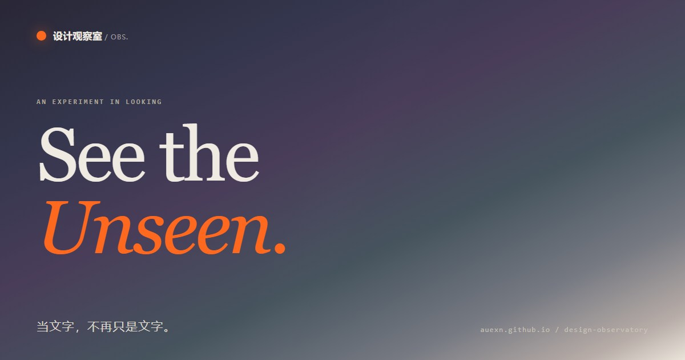

# 设计观察室 · Design Observatory

一个融合滚动叙事与动态交互的设计展示网页，把「设计」拆成可以亲手摆弄的东西。

**在线体验 → https://auexn.github.io/design-observatory/**

## 这是什么

不是教程，更像一间可以走进去的展厅。沿着九个章节往下读，可以滚动、点击、拖动，也可以在一张空白画布上把字重新捏一遍——熔铸、切片，或者干脆让它失序。

关于观察、秩序、文字、色彩与留白，以及一张海报到底是怎么长出来的。

## 章节

| # | 章节 | 一句话 |
|---|------|--------|
| 序 | 形态实验 | 可交互的抽象字体雕塑，熔铸 / 切片 / 失序三种状态 |
| 01 | 动态叙事 | 三幕式滚动叙事：观察 → 组织 → 感受 |
| 02 | 秩序 | 让信息找到秩序 |
| 03 | 文字 | 文字，也有自己的表情 |
| 04 | 色彩 | 色彩，是视觉的第一声问候 |
| 05 | 留白 | 留白，让重要的事被看见 |
| 06 | 设计案例 | 一张海报，如何被读懂 |
| 07 | 创意实验台 | 设计不止要看，亲手试试 |
| 08 | 灵感档案 | 灵感，藏在被忽略的细节里 |
| 09 | 设计宣言 | 设计没有标准答案 |

## 关于实现

- **单文件**：HTML、CSS、JavaScript 全部内联在 `index.html`，约 630 KB
- **零依赖**：不引用任何外部字体、库、图标或图片，断网也能完整打开
- **原生实现**：动画基于 CSS Transition 与 `requestAnimationFrame`；滚动叙事与入场使用 `IntersectionObserver`
- **可访问性**：支持「减少动态效果」系统设置、键盘操作、可见焦点样式，并提供屏幕阅读器标签与跳过导航链接

## 浏览器支持

Chrome / Edge / Safari / Firefox 的近期版本。

## 说明

这个页面由 AI 辅助完成，前后改动超过三十个版本。它并非我的原创设计，而是出于对动画与动效的兴趣，借 AI 之手做出来的一个尝试。

它保持单文件、零依赖：不需要构建，不需要联网，双击就能打开。

后续大概率不会再维护了，这一版就是最终形态。如果之后做出更满意的作品（不限于网页），还会继续分享。
